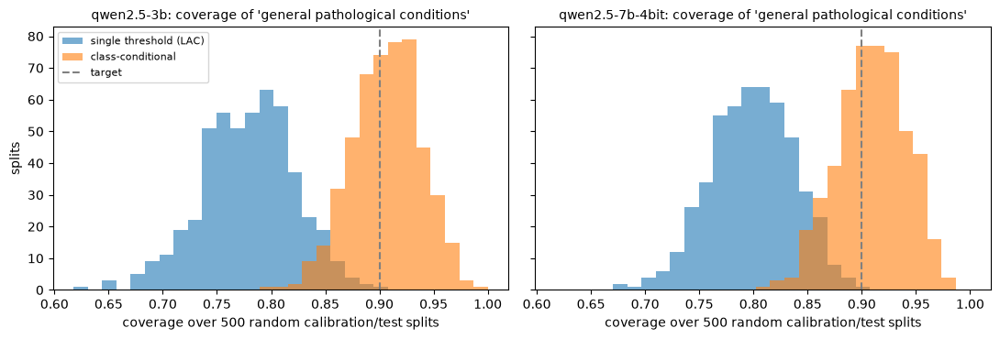
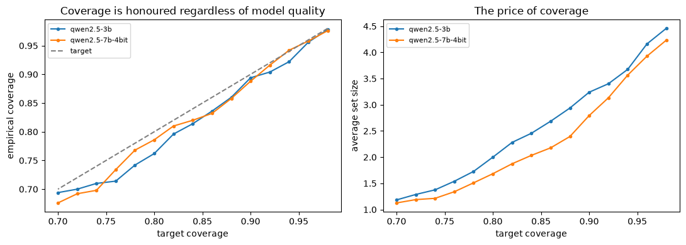
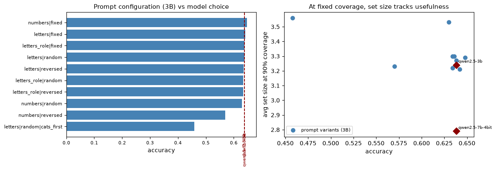

# How reliable is an LLM classifier? Calibration and conformal prediction on biomedical abstracts

Small open-weight LLMs used as zero-shot classifiers are **systematically overconfident**: on a 5-class biomedical abstract classification task, Qwen2.5-3B is right 59–64% of the time across three independent draws of data, while reporting 98–99% confidence on average. This project measures that gap and tests what post-hoc calibration and conformal prediction actually fix, and what they do not.

**Main findings**

1. **Overconfidence is large and does not shrink with model size.** The gap between mean confidence and accuracy is 0.34–0.40 for both the 3B and the 7B model, on all three draws, and it persists across all 10 prompt formulations tested (raw ECE between 0.33 and 0.40).
2. **Temperature scaling repairs the reported confidence without changing a single prediction.** Expected calibration error (ECE) falls from 0.35 to 0.05 (3B) and from 0.35 to 0.08 (7B) on the main draw, and stays between 0.04 and 0.09 after scaling on every draw. Accuracy is unchanged by construction.
3. **A marginal coverage guarantee hides a class that is badly covered, and this is not an accident of one split.** At a 90% target, conformal prediction (LAC) covers 89% of test abstracts overall, but the class *general pathological conditions* only 77% (3B) and 78% (7B). Over 500 random calibration/test re-splits, that class falls below 85% coverage in 96% (3B) and 90% (7B) of splits with a single threshold, against 4% and 3% with class-conditional (Mondrian) calibration.
4. **A small accuracy difference, a consistent usefulness difference.** The two models tie on the main draw (0.638) but not on the others: the 7B is ahead by 0.000, 0.012 and 0.032 on the three draws. At the same 90% coverage, its prediction sets are consistently smaller: 2.72 labels on average for 7B against 3.47 for 3B.
5. **On raw probabilities, the conformal threshold is numerically degenerate.** Because the models are so confident, the LAC threshold lands indistinguishably close to 1, and set membership is decided by probabilities in the numerical noise floor. After temperature scaling, the threshold becomes way more interpretable (about 0.93), albeit still high, with the same coverage.
6. **Prompt format matters more than model size.** With the 3B model fixed, accuracy ranges from 0.46 to 0.65 across prompt configurations. Even without the one outlier configuration, the spread (0.078) is more than twice the largest gain from moving to the 7B model (0.032; see the caveats below).
7. **A singleton prediction set is not a correct prediction.** The 7B model gives a single-label set to 12–14% of test examples, and 24–35% of those are wrong: conformal prediction guarantees coverage on average, not the correctness of individual sets.

## Results

### Main draw

Target coverage 90% (α = 0.10), 500 calibration and 500 test abstracts.

| Model | Accuracy | Mean confidence | ECE raw → scaled | Temperature | LAC coverage | LAC set size | Class-conditional set size |
| --- | --- | --- | --- | --- | --- | --- | --- |
| Qwen2.5-3B-Instruct | 0.638 | 0.987 | 0.353 → 0.052 | 7.41 | 0.894 | 3.24 | 2.48 |
| Qwen2.5-7B-Instruct (4-bit) | 0.638 | 0.987 | 0.350 → 0.080 | 9.96 | 0.888 | 2.79 | 2.54 |

Per-class coverage, LAC with a single threshold vs class-conditional thresholds:

| Class | n (test) | 3B marginal | 3B class-cond. | 7B marginal | 7B class-cond. |
| --- | --- | --- | --- | --- | --- |
| cardiovascular diseases | 116 | 0.966 | 0.905 | 0.940 | 0.940 |
| digestive system diseases | 51 | 0.980 | 0.941 | 0.922 | 0.804 |
| general pathological conditions | 165 | **0.770** | 0.909 | **0.782** | 0.897 |
| neoplasms | 97 | 0.928 | 0.897 | 0.990 | 0.918 |
| nervous system diseases | 71 | 0.958 | 0.915 | 0.887 | 0.930 |

The under-covered class is the catch-all category, the one whose abstracts overlap most with the other four. A single threshold lets the easy classes subsidise it; class-conditional thresholds redistribute coverage, lowering it on the easy classes towards the target. The smallest class (51 test examples) shows the other side: with few calibration points per class, class-conditional coverage can itself miss the target on a given split.

### Three independent draws

Mean over three disjoint draws of 500 + 500 abstracts, with the range in brackets.

| Metric | Qwen2.5-3B | Qwen2.5-7B (4-bit) |
| --- | --- | --- |
| Accuracy | 0.614 [0.586–0.638] | 0.629 [0.598–0.650] |
| ECE, raw | 0.373 [0.353–0.396] | 0.361 [0.342–0.392] |
| ECE, after temperature scaling | 0.049 [0.045–0.052] | 0.070 [0.043–0.086] |
| LAC coverage | 0.900 [0.894–0.908] | 0.880 [0.866–0.888] |
| LAC set size | 3.47 [3.24–3.59] | 2.72 [2.67–2.79] |
| Class-conditional set size | 2.66 [2.48–2.95] | 2.54 [2.21–2.87] |
| *General pathological conditions*, single threshold | 0.787 [0.770–0.806] | 0.760 [0.732–0.782] |
| *General pathological conditions*, class-conditional | 0.910 [0.905–0.917] | 0.896 [0.881–0.911] |

### 500 calibration/test re-splits

The 3,000 scored abstracts of each model are pooled and re-split at random into 500 calibration and 500 test abstracts, 500 times. Mean, with the 5th–95th percentile in brackets.

| Model | Overall LAC coverage | *General pathological conditions*, single threshold | Same class, class-conditional | Splits where that class is below 0.85 (single / class-cond.) |
| --- | --- | --- | --- | --- |
| Qwen2.5-3B | 0.902 [0.868–0.932] | 0.779 [0.705–0.846] | 0.906 [0.853–0.954] | 96% / 4% |
| Qwen2.5-7B (4-bit) | 0.902 [0.870–0.932] | 0.799 [0.737–0.859] | 0.909 [0.853–0.959] | 90% / 3% |







## Method

- **Data.** [TimSchopf/medical_abstracts](https://huggingface.co/datasets/TimSchopf/medical_abstracts) (11,550 abstracts, 5 condition classes), truncated to 2,000 characters. One fixed permutation (seed 0) gives three disjoint blocks of 500 calibration and 500 test abstracts; the first block is the main draw.
- **Models.** Qwen2.5-3B-Instruct (Hugging Face `transformers`) and Qwen2.5-7B-Instruct quantised to 4 bits (`mlx-lm`, Apple Silicon).
- **Scoring.** Each abstract is presented with the five classes as lettered options; the class probabilities are the softmax of the next-token logits restricted to the option letters. The option order is shuffled for each example, with a deterministic per-example seed (`zlib.crc32` of the example's identifier), to remove position bias.
- **Calibration.** Temperature scaling fitted by minimising the negative log-likelihood on the calibration set; ECE with 15 bins.
- **Conformal prediction.** Split conformal with the LAC and APS scores, and class-conditional (Mondrian) LAC with one threshold per class, all calibrated on the same 500 abstracts.
- **Variability.** The full analysis is repeated on the three disjoint draws. Separately, the 3,000 scored abstracts per model are re-split at random 500 times (seed 1) to measure how coverage moves with the calibration draw.
- **Prompt ablation.** Qwen2.5-3B on the main draw, with three marker styles (letters, numbers, letters with a role preamble), three option orderings (fixed, reversed, random) and one structural variant (categories before the abstract): 10 configurations.

## Limitations

- **Finite samples.** With 500 test examples, coverage on a single draw fluctuates by a few points: the 7B model sits at 0.87–0.89 on all three draws, while its average over the 500 re-splits is 0.90. The re-splits reuse the same 3,000 abstracts, so they measure variability due to the calibration draw, not to new data. Class-conditional coverage rests on 50 to 170 calibration examples per class and fluctuates more; its guarantee holds on average over calibration draws, not for every single split.
- **The model comparison is confounded.** The 7B model is 4-bit quantised and runs on a different backend, so the 3B → 7B comparison mixes model size, quantisation and implementation. "Prompt matters more than size" is a statement about this pair of models, not a general law.
- **The prompt ablation uses the main draw only,** and its spread is driven partly by one outlier: placing the categories before the abstract drops accuracy to 0.46; without that configuration, the spread is 0.57 to 0.65.
- **GPU inference is not bit-exact.** Prompt configurations whose option order does not depend on any seed (fixed and reversed) reproduce across runs to within 0.008 in accuracy, the trace of bfloat16 non-determinism on Apple GPUs flipping a handful of near-tied predictions.
- **Zero-shot only, research data.** No fine-tuning, no clinical data, no claim about clinical use.

## Reproduce

```bash
pip install -r requirements.txt
pip install mlx-lm   # Apple Silicon only, for the 7B model
jupyter notebook Conformal_LLM_clean.ipynb
```

Run the cells top to bottom. Model outputs are cached under `cache_crc32/`, so the analysis cells re-run in seconds once scoring is done. A full run scores 13,000 abstracts with the 3B model (three draws plus the prompt ablation) and 3,000 with the 7B model, which takes several hours on a recent laptop. If you change the seeding or the prompt, change the cache folder name: cache keys do not record either.

## Repository structure

```
Conformal_LLM_clean.ipynb   notebook: data, scoring, calibration, conformal prediction, prompt ablation, replicates
figures/                    coverage_vs_alpha.png, set_sizes.png, prompt_ablation.png, resplit_gpc_coverage.png
results/                    model_comparison.csv, prompt_ablation.csv, replicates.csv, resplits.csv
requirements.txt
```

## Author

Pietro Marco Gallo, Specialised Master in Trustworthy AI, CentraleSupélec.
